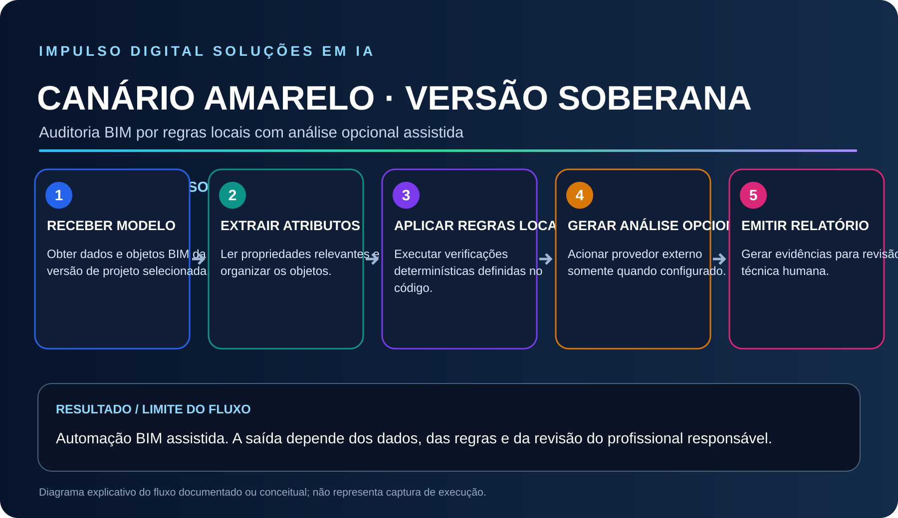
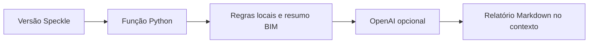

 |  | 

# Canário Amarelo — Automação Speckle para BIM

  

## Visão geral

Pelo código, o núcleo do repositório é uma função Python para Speckle Automate que recebe um objeto BIM, percorre a hierarquia, resume tipos de objetos e verifica localmente a ausência do atributo material em objetos cujo tipo contém 'Structure'. Com uma chave OpenAI, envia resumo e prompt a gpt-4o-mini e grava relatório_aurora.md; sem chave, grava um relatório de modo local. Há também scripts de chat e mídia em canario.py, separados desse fluxo central. A descrição aspiracional do README (IA soberana, explicável, multimodal) não é inteiramente sustentada pelo núcleo implementado.

## Objetivo e valor

**Problema/escopo:** Função Python para Speckle Automate que resume objetos BIM e produz relatórios de auditoria com regras locais e análise opcional via OpenAI.

**Valor verificável hoje:** o repositório torna explícitos seus artefatos, interfaces e limitações para que mantenedores e contribuidores possam avaliar o que existe sem confundir demonstração, proposta e produção.

## Arquitetura e tecnologias

Parcialmente inferível, mas não documentada como arquitetura no README: main.py define FunctionInputs e automate_function para Speckle Automate; flatten.py percorre recursivamente elements/@elements; speckle_automate_stub e tests oferecem suporte local; workflow gera o schema e publica/executa a função. canario.py/chat.py são interfaces CLI adicionais. Não há evidência de que componham uma única aplicação multimodal integrada.

- Python; GitHub identifica Python como linguagem do repositório.
- Python >=3.11 declarado em pyproject.toml; mise.toml e Dockerfile especificam Python 3.11.
- Dependências runtime declaradas: specklepy >=3.2.4, openai >=1.0.0 e pydantic >=2.0.0.
- Integração Speckle Automate: main.py importa SDK real ou stub local; CI usa ação Speckle Automate.
- Pytest/Ruff constam como dependências/opcionais de desenvolvimento no manifesto; existe tests/test_function.py.
- OpenAI API aparece no código; main.py especifica gpt-4o-mini, e canario.py contém chamadas de chat, imagem e vídeo.
- Dockerfile baseado em python:3.11-slim; há workflow GitHub Actions para build/publicação de versões Speckle Automate.
- Além de Python, árvore inclui manifestos TOML, arquivos de dependências, JSON de entradas de exemplo e configuração de GitHub Actions.

## Início rápido

Os comandos abaixo refletem instruções, manifestos ou pontos de entrada presentes no repositório. Dependências externas, segredos e serviços estão indicados quando aplicável; a presença de um comando não equivale a uma execução validada.

1. O README lista criação de ambiente virtual com `python -m venv .venv`, ativação (`source .venv/bin/activate`) e instalação por `pip install -r requirements.txt`; o manifesto confirma os requisitos Python >=3.11 e requirements.txt lista dependências. O comando de clone do README usa URL e diretório placeholder e não deve ser copiado sem correção.
2. Instalação usada pelo workflow público: `pip install .[dev]`.
3. Comando comprovado no workflow para gerar schema: `python main.py generate_schema <caminho-do-schema>`; no YAML, o destino concreto é `${HOME}/functionSchema.json`.
4. Workflow configura a função para execução como `python -u main.py run`, invocada pela ação Speckle Automate após publicação; não é um passo de CI que demonstre execução bem-sucedida neste levantamento.
5. README recomenda `python -m pytest -q` e existe teste com pytest, mas não executei testes e o workflow observado não contém etapa de pytest.
6. README também sugere `python main.py` sem argumentos; o código delega a execução a execute_automate_function, mas esse comando não é validado como fluxo interativo independente.

## Exemplo de uso

Exemplo possível a partir da interface real separada: com dependências instaladas e credencial OpenAI válida, definir `OPENAI_API_KEY` e executar `python canario.py`; escolher `1`, conversar pelo terminal e digitar `sair`. O script chama gpt-4o-mini e depende de serviço/credencial externos. Isso não é exemplo de execução local da função Speckle Automate.

## Estado e limitações

**Estado de entrega:** automação BIM em desenvolvimento.

- Não tratar as alegações de 'IA soberana', XAI, auditoria de duplicidade ou recursos multimodais do README como capacidades comprovadas da função principal.
- O núcleo main.py envia resumo do modelo BIM e prompt à OpenAI quando recebe chave; portanto, a designação 'soberana' não comprova operação independente ou local.
- O código local examina no máximo os primeiros 150 objetos na contagem/regras, enquanto informa total de objetos; a documentação não explica esse limite.
- O teste existente usa speckle_automate_stub e chave vazia, portanto não demonstra integração real com servidor Speckle nem análise externa. Não executei os testes.

## Contribuição

Leia [CONTRIBUTING.md](CONTRIBUTING.md) antes de abrir uma issue ou pull request. Para reportes de segurança, siga a orientação específica do repositório, se houver.

## Licença

Este repositório está licenciado sob **Apache-2.0**; consulte [LICENSE](LICENSE).

## Patrocínio e apoio

O desenvolvimento aberto exige tempo para manutenção, documentação, testes, revisão de contribuições e resposta a issues. Se este projeto for útil, considere apoiar a continuidade pelo [GitHub Sponsors](https://github.com/sponsors/felipetjmg1-bit). O apoio não representa promessa de funcionalidades, prazo de entrega ou suporte comercial.

---

**Empresa responsável:** Impulso Digital Soluções em IA.

## Fluxo passo a passo

Consulte o [guia textual com as etapas do projeto](docs/PROCESSO-PASSO-A-PASSO.md). O infográfico acima resume visualmente o mesmo fluxo.
